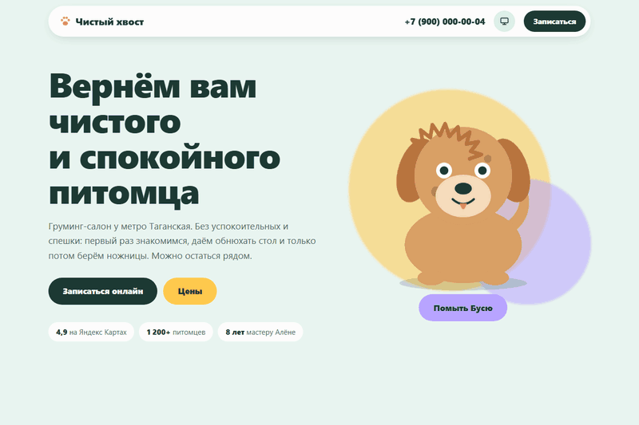
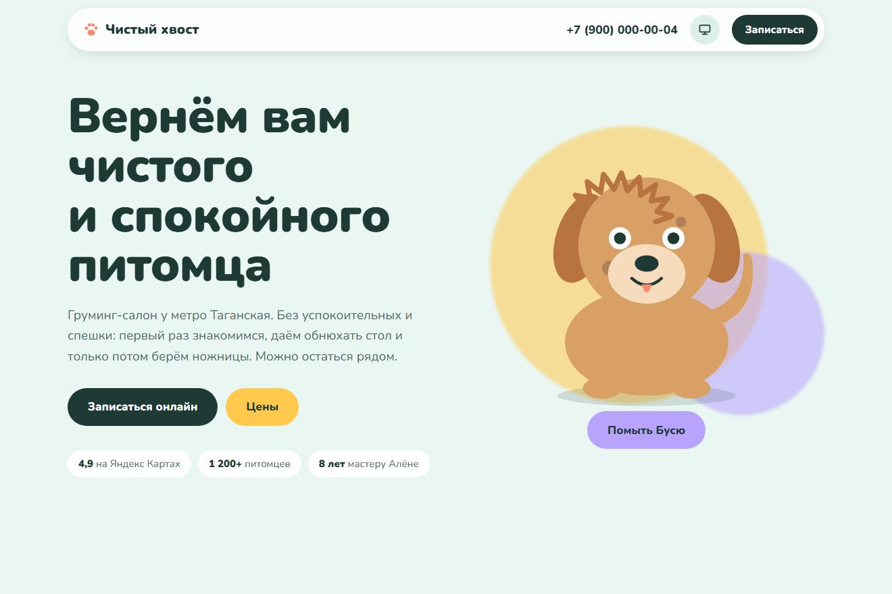
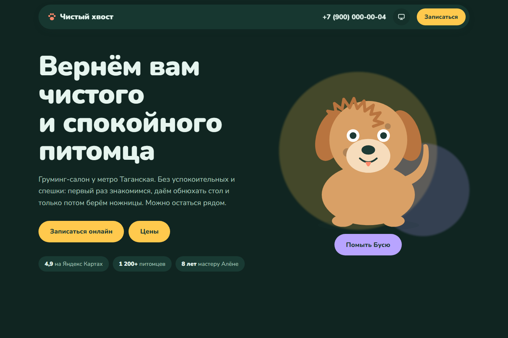
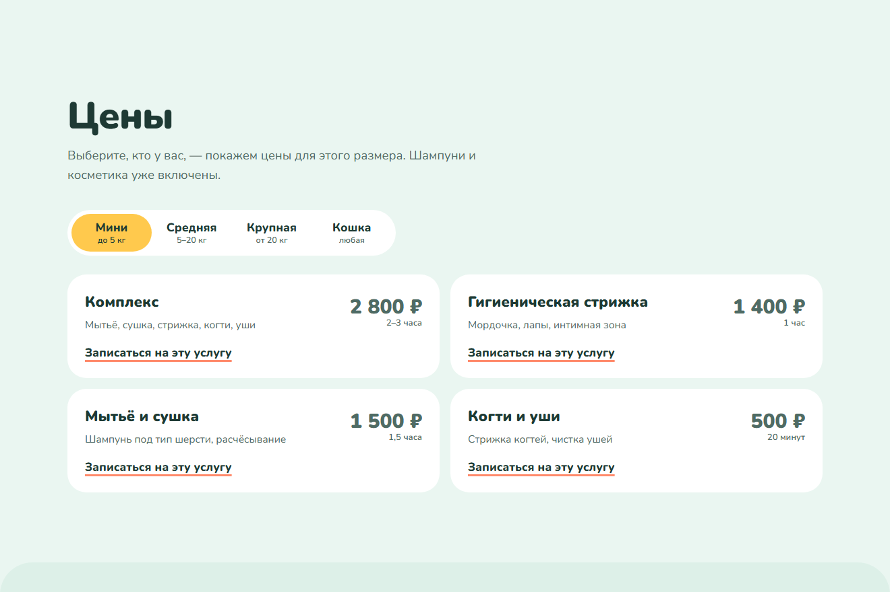
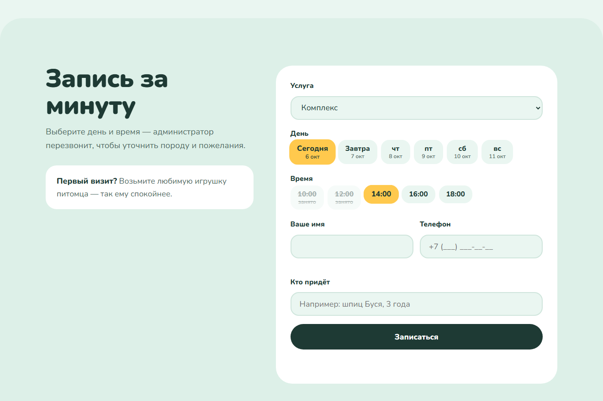

# Чистый хвост — лендинг груминг-салона

**Демо:** https://znikdk.github.io/landing-grooming/



Демо-лендинг для портфолио. Ниша: груминг-салон для собак и кошек. Пакет: Эконом (3 блока: оффер, цены, запись).

## Скриншоты

| Светлая тема | Тёмная тема |
|---|---|
|  |  |

| Цены по размеру питомца | Онлайн-запись |
|---|---|
|  |  |

## Стиль

Мягкий «пухлый» стиль: мятный фон, пастельные пятна, крупные скругления, пружинящие кнопки. Тёмная тема — глубокий хвойный.

## Интерактив

- Пёс Буся: глаза следят за курсором, хвост виляет, по клику прыгает и лает
- Кнопка «Помыть Бусю»: мыльные пузыри, шерсть из лохматой становится причёсанной, появляется бантик
- Цены переключаются по размеру питомца, подложка вкладки переезжает с «пружиной»
- Запись: выбор дня и свободного времени, занятые слоты зачёркнуты; сердечки после отправки

## Что есть всегда

- Светлая и тёмная тема плюс режим «как в системе», смена темы с круговым «проявлением» (View Transitions API).
- Адаптив от 360 px.
- Анимации учитывают настройку «уменьшить движение» (`prefers-reduced-motion`); тяжёлые эффекты работают, только пока блок на экране.
- Форма заявки: маска телефона, проверка полей, защита от ботов (honeypot) и от двойной отправки.
- Иллюстрации нарисованы кодом (SVG и CSS): без фото и без сторонних JS-библиотек.

## Как перенастроить под клиента

1. `config.js` — название, телефон, почта, Telegram, адрес приёма заявок и данные калькулятора или прайса.
2. `style.css`, блок `:root` — цвета и шрифты обеих тем.
3. Тексты — в `index.html`.

Заявки: если `endpoint` в `config.js` пустой, форма работает в демо-режиме. Для боевого режима укажите адрес функции из проекта [landing-demo](https://github.com/ZniKDK/landing-demo): заявка уходит в Telegram, запасной канал — почта.

## Структура

```
index.html   разметка и тексты
style.css    оформление, темы, анимации
app.js       интерактив этого сайта
config.js    данные клиента
lib/         общие модули: тема, анимации, форма, подстановка данных
```

## Запуск

```bash
python -m http.server 8000
```

Затем откройте http://localhost:8000.

## Лицензии

Код — MIT. Шрифты из Google Fonts под лицензией OFL: Nunito. Компания, люди и отзывы вымышлены.
